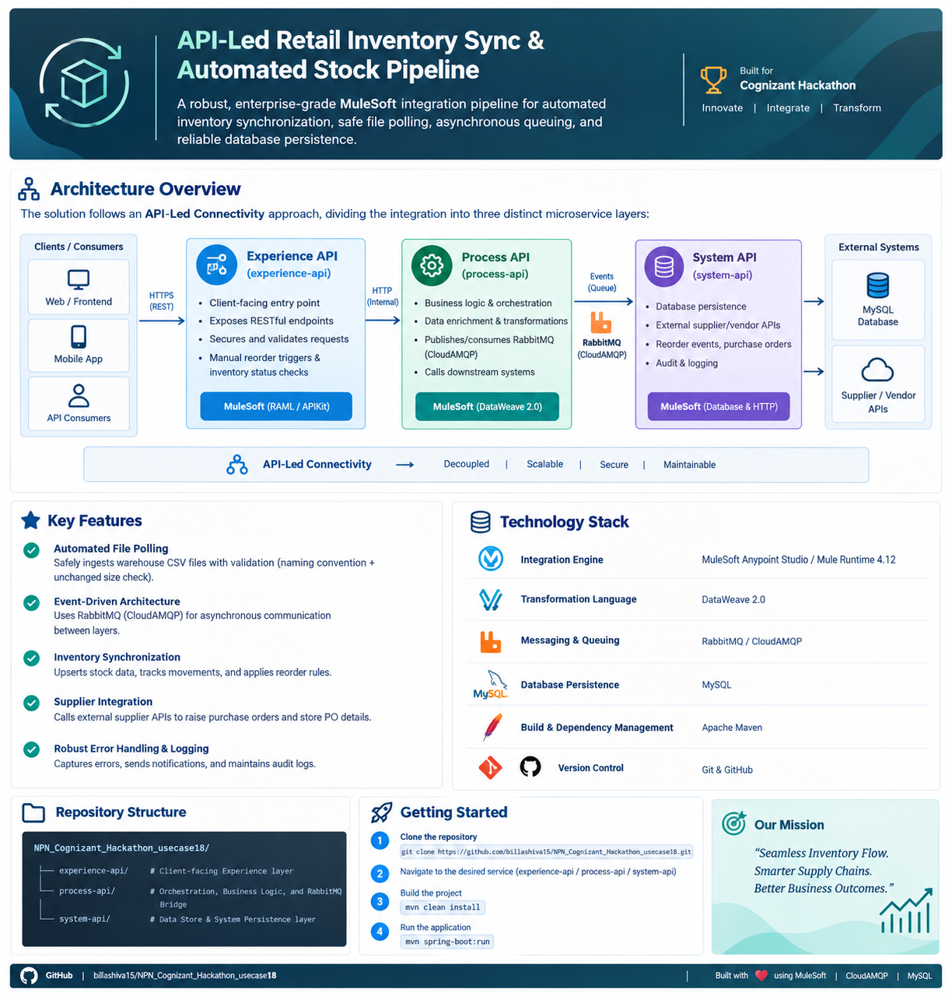
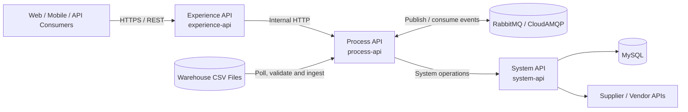

# 🚀 API-Led Retail Inventory Sync & Automated Stock Pipeline

[](https://www.mulesoft.com/)
[](https://docs.mulesoft.com/dataweave/latest/)
[](https://www.rabbitmq.com/)
[](https://www.mysql.com/)
[](https://maven.apache.org/)
[](https://github.com/)

A robust, API-led MuleSoft integration solution built for the **Cognizant Hackathon**. The pipeline is designed to synchronize retail inventory, validate incoming warehouse files, process reorder events asynchronously, integrate with supplier systems, and persist inventory and purchase-order data.

> **Project goal:** deliver a decoupled, maintainable, and observable inventory integration pipeline using Experience, Process, and System API layers.

---

## 📌 Table of Contents

- [Architecture Overview](#-architecture-overview)
- [Key Capabilities](#-key-capabilities)
- [Technology Stack](#-technology-stack)
- [Repository Structure](#-repository-structure)
- [End-to-End Workflow](#-end-to-end-workflow)
- [Getting Started](#-getting-started)
- [Configuration](#-configuration)
- [API Design Guidance](#-api-design-guidance)
- [Reliability and Security](#-reliability-and-security)
- [Development Workflow](#-development-workflow)
- [Roadmap](#-roadmap)
- [Contributing](#-contributing)

---

## 🏗️ Architecture Overview

The solution follows **API-Led Connectivity**, separating consumer experience, business orchestration, and backend connectivity into independently maintainable layers.

### Architecture diagram



*The diagram is a high-level visual overview. The Mermaid diagram below provides an editable representation of the intended integration boundaries.*



### API responsibilities

| Layer | Responsibility | Typical operations |
|---|---|---|
| **Experience API** | Consumer-facing entry point; exposes REST resources and applies consumer-level validation or policies. | Inventory lookups, manual reorder requests, purchase-order status queries. |
| **Process API** | Coordinates business rules, data transformation, asynchronous messaging, and downstream orchestration. | Validate inventory changes, determine reorder eligibility, publish and consume reorder events. |
| **System API** | Encapsulates connectivity to backend systems and vendor services. | Persist inventory and audit data, retrieve records, call supplier endpoints. |

**Design principle:** consumers should not need to know the details of the database schema, message broker, or supplier implementation.

---

## ✨ Key Capabilities

- **Warehouse file ingestion** — supports a file-driven inventory workflow for warehouse CSV feeds.
- **Safe file processing** — validate expected file naming and file readiness before processing; avoid ingesting partially written files.
- **Inventory synchronization** — transform incoming records and persist stock updates.
- **Asynchronous event-driven processing** — use RabbitMQ / CloudAMQP to decouple reorder requests from downstream processing.
- **Automated reorder orchestration** — apply configurable reorder rules and coordinate purchase-order creation.
- **Supplier integration** — call external supplier APIs through a dedicated system integration boundary.
- **Persistence and auditability** — store inventory, reorder, purchase-order, and processing history in MySQL.
- **Error handling and observability** — provide consistent error responses, logs, and traceable processing outcomes.

> Features should be marked as implemented only after the corresponding flows, configuration, and tests are present in the repository.

---

## 🧰 Technology Stack

| Area | Technology |
|---|---|
| Integration runtime | MuleSoft Anypoint Studio / Mule Runtime 4.12 |
| API specification | RAML 1.0 (recommended for API contracts) |
| Transformation | DataWeave 2.0 |
| Messaging | RabbitMQ / CloudAMQP |
| Database | MySQL |
| Build and dependencies | Apache Maven |
| Version control | Git and GitHub |

---

## 📂 Repository Structure

```text
NPN_Cognizant_Hackathon_usecase18/
├── experience-api/       # Client-facing REST API and API contract
├── process-api/          # Business rules, orchestration and messaging
├── system-api/            # Database and supplier-system connectivity
├── docs/
│   └── architecture-overview.png
└── README.md
```

Each API layer should remain independently understandable, with its own configuration, Mule flows, API specification where applicable, and tests.

---

## 🔄 End-to-End Workflow

1. **Receive inventory input** — warehouse CSV files arrive in the configured inbound location.
2. **Check readiness and validate** — verify the expected file pattern, file stability, and required fields before processing.
3. **Transform and persist** — map source records into the canonical inventory model and update MySQL through the appropriate system integration flow.
4. **Evaluate stock rules** — compare available quantities with configured reorder thresholds.
5. **Publish a reorder event** — send eligible reorder requests to RabbitMQ / CloudAMQP so downstream work can proceed asynchronously.
6. **Process the event** — the consumer applies business safeguards and coordinates supplier and database operations.
7. **Record the outcome** — persist purchase-order references and processing status; retain sufficient logs for support and audit.
8. **Expose status to consumers** — use the Experience API to retrieve inventory, submit supported reorder requests, or check purchase-order status.

---

## 🚀 Getting Started

### Prerequisites

Install or obtain access to:

- Anypoint Studio compatible with Mule Runtime 4.12
- A supported Java JDK configured for your MuleSoft development environment
- Git
- Apache Maven (or the Maven installation bundled with Anypoint Studio)
- A MySQL database and credentials
- A RabbitMQ / CloudAMQP instance and connection credentials
- Supplier API endpoint details, if supplier integration is enabled

### 1. Clone the repository

```bash
git clone https://github.com/billashiva15/NPN_Cognizant_Hackathon_usecase18.git
cd NPN_Cognizant_Hackathon_usecase18
```

### 2. Import the API projects

In Anypoint Studio, import each Mule project as an existing project. Open and configure `experience-api`, `process-api`, and `system-api` separately if they are maintained as independent Mule applications.

### 3. Configure environment properties

Create local development properties using the configuration keys expected by each Mule project. Keep credentials out of source control.

Example placeholder configuration:

```properties
# Database
db.host=YOUR_MYSQL_HOST
db.port=3306
db.name=YOUR_DATABASE_NAME
db.user=YOUR_DATABASE_USER
db.password=SET_LOCALLY

# RabbitMQ / CloudAMQP
mq.host=YOUR_BROKER_HOST
mq.port=5672
mq.username=SET_LOCALLY
mq.password=SET_LOCALLY
mq.virtualHost=SET_LOCALLY

# Supplier service
supplier.baseUrl=https://YOUR_SUPPLIER_API
supplier.apiKey=SET_LOCALLY
```

These are illustrative property names. Match them to the actual configuration files and connectors in your Mule projects.

### 4. Build the project

From each Mule application's directory, run:

```bash
mvn clean package
```

If your project uses Mule Maven Plugin deployment goals or environment-specific profiles, follow the configuration in that project's `pom.xml`.

### 5. Run and verify

Run the Mule application from Anypoint Studio or with the documented Maven workflow. Verify database connectivity, broker connectivity, API listener ports, and supplier credentials before testing end-to-end processing.

---

## ⚙️ Configuration

Use environment-specific configuration for local development, testing, and deployment. Recommended configuration categories:

- HTTP listener host and port
- MySQL connection details and connection pool settings
- RabbitMQ / CloudAMQP host, port, virtual host, and credentials
- Supplier API base URL, authentication, and timeouts
- Inventory file inbound, archive, and rejected-file locations
- Reorder thresholds and other business rules
- Logging level and correlation ID settings

**Never commit real passwords, API keys, access tokens, private certificates, or production connection strings.** Use secure properties or the deployment platform's secret-management facilities.

---

## 🔌 API Design Guidance

Use RAML 1.0 to document resource paths, methods, request and response schemas, examples, and standard error responses. Exact endpoint paths depend on the API contracts implemented in this repository.

Potential Experience API resources include:

| Resource purpose | Suggested method | Notes |
|---|---|---|
| Retrieve stock for a SKU | `GET` | Return stock by SKU and, where appropriate, warehouse/location. |
| Submit a reorder request | `POST` | Validate the request and return an accepted/created response with a tracking reference. |
| List or retrieve reorder requests | `GET` | Support filtering and pagination where needed. |
| Check purchase-order status | `GET` | Return status and supplier reference when available. |

Treat these as design recommendations, not a claim that every endpoint is already implemented.

---

## 🛡️ Reliability and Security

For a production-oriented implementation, consider the following safeguards:

- **Idempotency:** prevent duplicate file ingestion and duplicate reorder or purchase-order creation.
- **Message reliability:** define acknowledgement, retry, dead-letter, and redelivery behavior for failed queue messages.
- **Timeouts and retries:** set bounded timeouts and safe retry policies for transient supplier failures.
- **Error strategy:** return consistent API error payloads and log actionable diagnostic context.
- **Correlation IDs:** carry a correlation identifier across API calls, queue messages, and downstream requests.
- **Data validation:** validate required fields, types, quantities, timestamps, and allowed values before persistence.
- **Least privilege:** use dedicated credentials with the minimum permissions needed.
- **Secrets management:** store sensitive values outside Git and rotate them regularly.
- **Testing:** add MUnit tests for transformations, validation, error paths, and core business rules.

---

## 🧪 Development Workflow

Recommended checks before merging a change:

1. Validate the RAML specification and examples.
2. Run Maven packaging for each changed Mule application.
3. Run available MUnit tests.
4. Test success, validation failure, database failure, broker failure, and supplier timeout paths.
5. Confirm logs contain useful correlation information but no secrets or sensitive payloads.
6. Update this README when architecture, configuration, or operational steps change.

---

## 🗺️ Roadmap

- [ ] Finalize RAML contracts and reusable data types.
- [ ] Implement and test the Experience API resources.
- [ ] Implement Process API orchestration and business rules.
- [ ] Implement System API database and supplier operations.
- [ ] Configure RabbitMQ / CloudAMQP publishing, consumption, retries, and dead-letter handling.
- [ ] Add duplicate-processing protection and audit records.
- [ ] Add MUnit coverage for critical flows and failure scenarios.
- [ ] Document deployment environments and operational monitoring.

---

## 🤝 Contributing

Contributions and suggestions are welcome. For changes, create a focused branch, explain the design decision in the pull request, and include tests or reproducible verification steps where possible.

1. Fork or branch from the repository.
2. Make a focused change.
3. Run the applicable build and tests.
4. Update documentation.
5. Open a pull request with a concise summary and test evidence.

---

## 👨‍💻 Project

**NPN Cognizant Hackathon — Use Case 18**  
Repository: [billashiva15/NPN_Cognizant_Hackathon_usecase18](https://github.com/billashiva15/NPN_Cognizant_Hackathon_usecase18)

*Designed to demonstrate API-led integration, asynchronous messaging, inventory synchronization, and maintainable MuleSoft architecture.*
